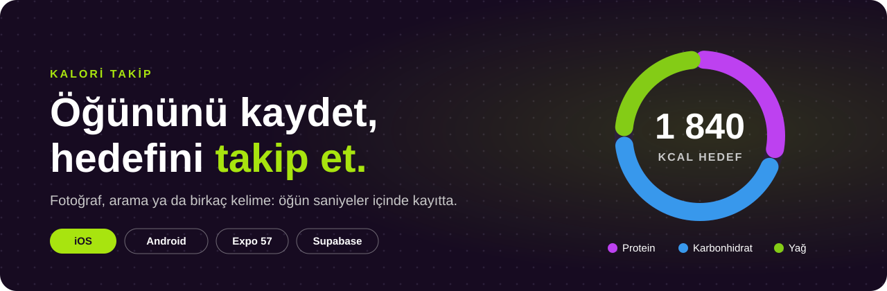
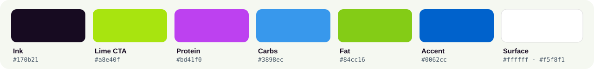

<p align="center">
  
</p>

<p align="center">
  
  
  
  
  
</p>

<p align="center">
  A Turkish calorie and macro tracker for iOS and Android, built with Expo on Supabase.<br>
  <b>Log a meal by photo, search or a few words · follow a plan that adjusts · train with a program that progresses.</b>
</p>

---

## ✨ What it does

| | Feature | |
|:-:|---|---|
| 🍽️ | **Meal logging** | Food search with grams and portion shortcuts; photo and text-description logging through one AI Edge Function |
| 🎯 | **Plan wizard** | A short first-time setup builds your calorie and macro targets; live tuning afterwards |
| 📊 | **Today and history** | Dashboard with the macro ring, a calendar of past days, every meal editable |
| 🏋️ | **Workout program** | Your own split (Push / Pull / Legs, Upper / Lower, …), logging prefilled from last time, best kg and estimated 1RM |
| 📅 | **Weekly plan** | Every Sunday 18:00 the next week is planned from what you lifted (double progression, deloads) |
| 🔐 | **Accounts** | E-mail and password, Google, Sign in with Apple; session stored encrypted on the device |

### 🟣 🔵 🟢 Macros, at a glance

The app gives each macro one colour everywhere, from the ring on the dashboard to the chips in search:

| Macro | Colour | Token |
|---|---|---|
| 🟣 Protein |  | `macroProtein` |
| 🔵 Carbs |  | `macroCarbs` |
| 🟢 Fat |  | `macroFat` |
| ⚫ Calories |  | `macroCalories` |

---

## 📱 How it works

```text
  👤 Sign up  ──▶  📝 Setup  ──▶  🎯 Your plan  ──▶  🍽️ Log meals  ──▶  📊 Track  ──▶  🏋️ Train
```

1. **👤 Sign up** with e-mail, Google or Apple. The session is stored encrypted on the phone.
2. **📝 Setup** asks a few questions: age, height and weight, your goal, how active you are and how you eat.
3. **🎯 Your plan** turns those answers into a daily calorie target split into protein, carbs and fat. You can tune it live in the plan wizard and see the numbers move.
4. **🍽️ Log meals** the way that suits the moment:
   - 🔎 search 553 foods and Turkish dishes, pick grams or a portion like "1 kase"
   - 📸 snap a photo of the plate
   - ✍️ type a few words, like "2 yumurta ve bir dilim ekmek"
5. **📊 Track** the day on the macro ring; open any past day from the calendar and edit its meals.
6. **🏋️ Train** with your own split. Each workout starts from last time's weights, and every Sunday the next week is planned from what you lifted.

---

## 🚀 Quick start

> [!NOTE]
> You need **Node 22+**, npm, a **Supabase** project (URL + publishable key) and **Expo Go** or a development build on a phone. Google and Apple sign-in need a development build.

```bash
npm install                                    # 1️⃣ all workspaces
cp apps/mobile/.env.example apps/mobile/.env   # 2️⃣ EXPO_PUBLIC_SUPABASE_URL, EXPO_PUBLIC_SUPABASE_KEY
npx supabase link --project-ref <ref>          # 3️⃣ then apply supabase/migrations (see supabase/README.md)
npm run mobile                                 # 4️⃣ Metro; scan the QR code
```

### 🌐 Try it in the browser

```bash
npm run web                                    # expo start --web → http://localhost:8081
```

> [!WARNING]
> The web build is **for development testing only** and is never published (constitution: no web front end).
> E-mail sign-in works; Google, Apple, notifications and the `kaloritakip://` e-mail links do not.
> On the web the session sits unencrypted in `localStorage`.

Full setup and the manual validation steps:
[specs/001-mobile-foundation/quickstart.md](specs/001-mobile-foundation/quickstart.md).

---

## 🧰 Commands

| | Command | What it does |
|:-:|---|---|
| 🧪 | `npm test` | Core and app unit and property tests |
| 🔎 | `npm run typecheck && npm run lint && npm run knip` | Types, layer rules, unused code |
| 🖼️ | `npm run preview` | Screen gallery (`tools/preview/dist/artifact.html`) |
| 📱 | `maestro test .maestro/smoke.yaml` | Smoke flow on a device or emulator |
| 🥗 | `npm run build -w fooddata` | Food list: rules, summary, review page |
| ✅ | `npm run check -w fooddata` | Committed food list matches its sources |
| 🤖 | `npm run eval:text -w aieval` | Text preview on the phrase set (AI logging) |
| ⚡ | `npm run test:functions -w @calorie/db` | Edge Function tests (Deno) |

---

## 🗂️ Project layout

```text
calorie-tracker/
├── 📱 apps/mobile/          Expo Router app (screens in src/app, Supabase only in src/services)
├── 🧠 packages/core/        Pure TypeScript: nutrition and plan math, food search, workout engine
├── 🗄️ supabase/             Migrations, pgTAP tests, Edge Functions
├── 🛠️ tools/
│   ├── fooddata/            USDA-sourced food list builder
│   ├── aieval/              AI logging evaluation set
│   └── preview/             Web screen gallery for reviews (never shipped)
├── 📐 specs/                Spec Kit features and the roadmap
└── 🎨 tofuhq-design/        Design system
```

---

## 🎨 Design

<p align="center">
  
</p>

Deep **ink** for the header band and text, white surfaces, **lime** for the one primary action per
screen, **blue** only for links and focus. Headings and big numbers use **Bricolage Grotesque Bold**.
Every colour, space and radius comes from [`apps/mobile/src/theme.ts`](apps/mobile/src/theme.ts);
nothing is hard-coded in components.

---

## 🥦 Food data

Food values come from **USDA FoodData Central** (public domain, CC0). Turkish dishes are computed
from recipes of USDA ingredients. TürKomp is not used.

Database migrations and pgTAP tests: [supabase/README.md](supabase/README.md).

## 📚 Where things are written down

- 📜 **Rules:** `.specify/memory/constitution.md`; features live in `specs/` (Spec Kit).
- 🏗️ **Architecture and conventions:** `CLAUDE.md`.
- 🎨 **Design system:** `tofuhq-design/` and the tokens in `apps/mobile/src/theme.ts`.

<p align="center"><sub>Built with 🟢 lime and ⚫ ink · Made in Türkiye 🇹🇷</sub></p>
